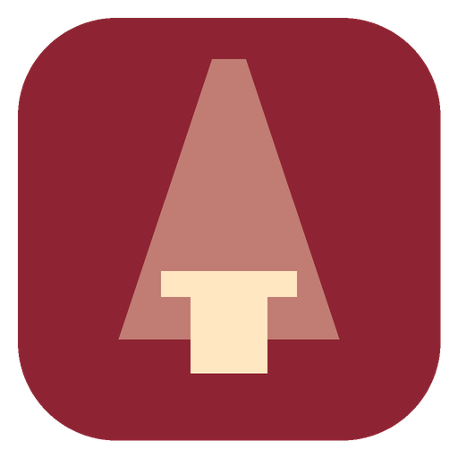
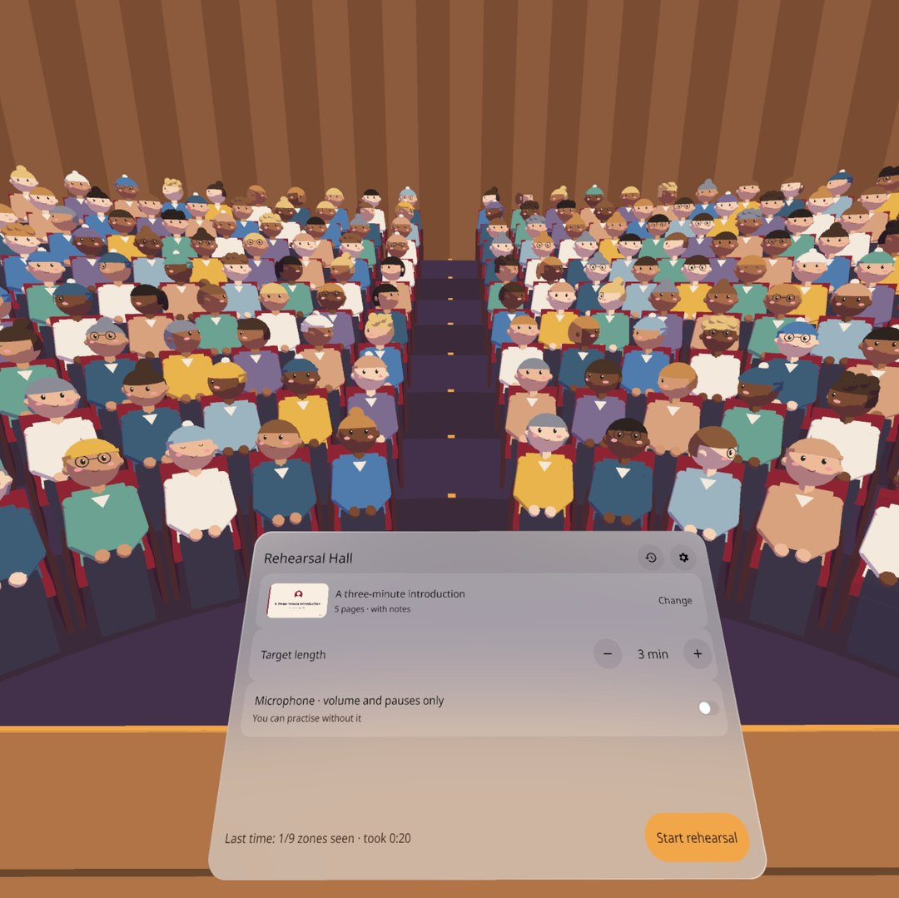
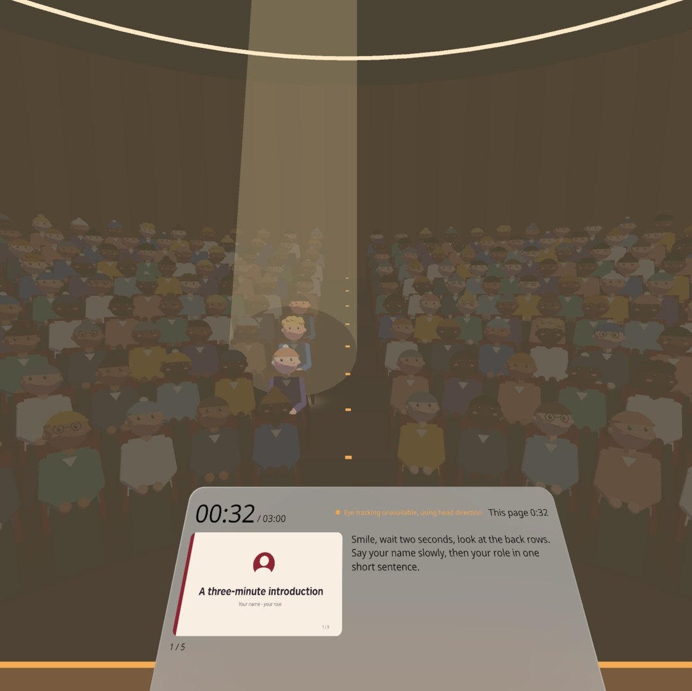
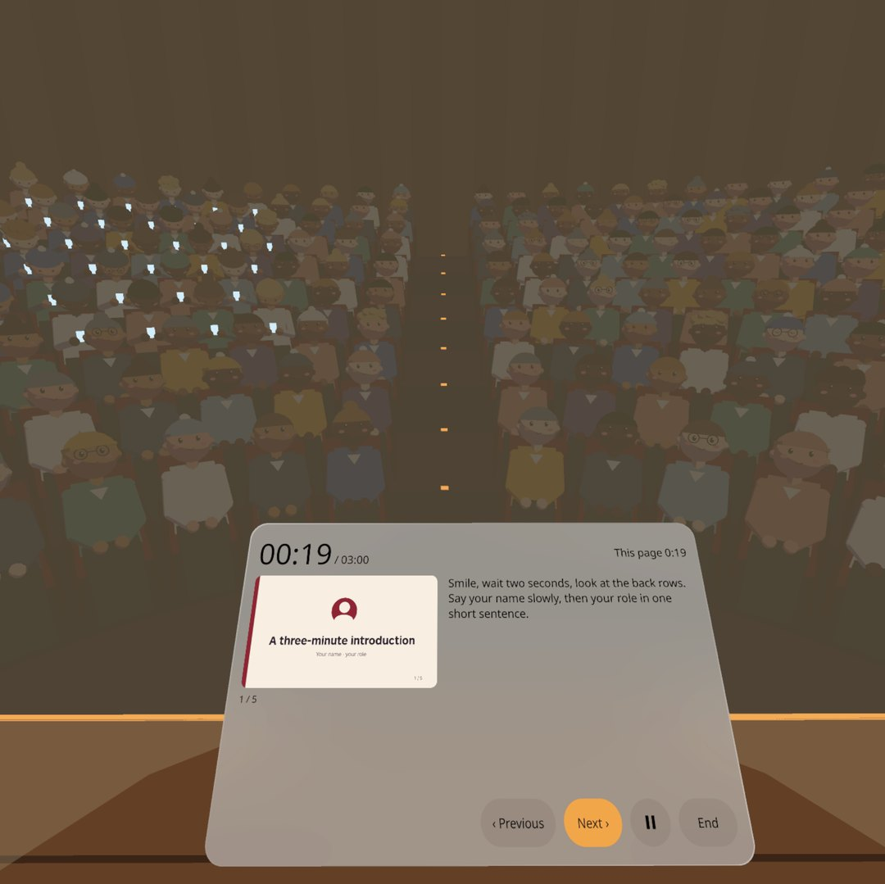
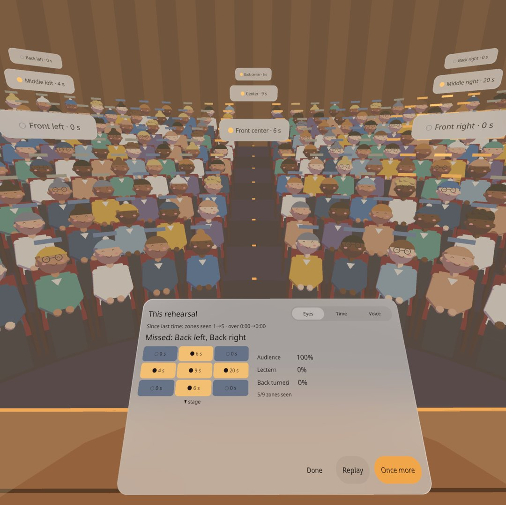
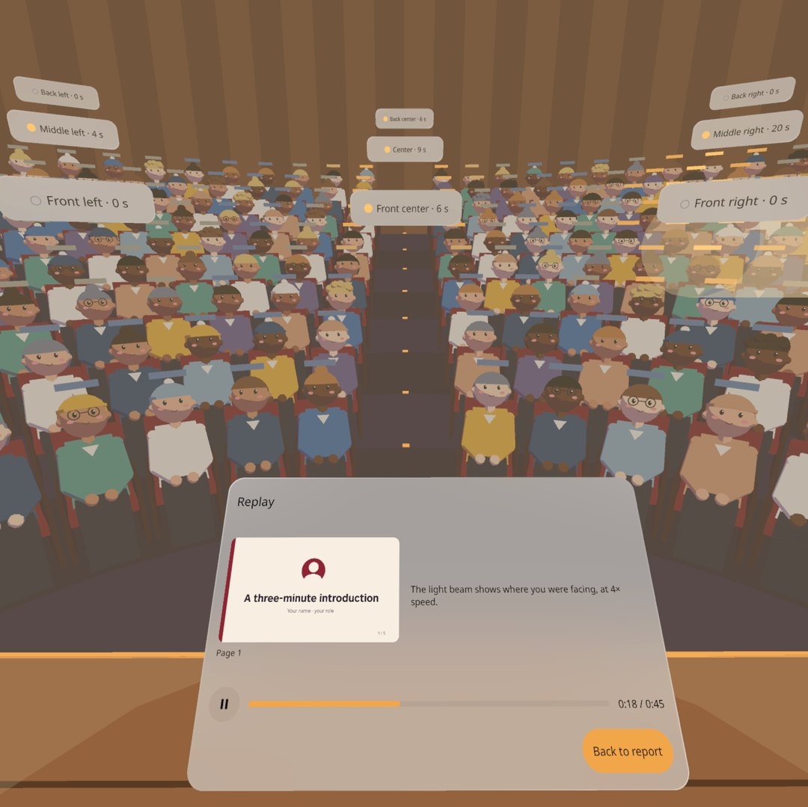
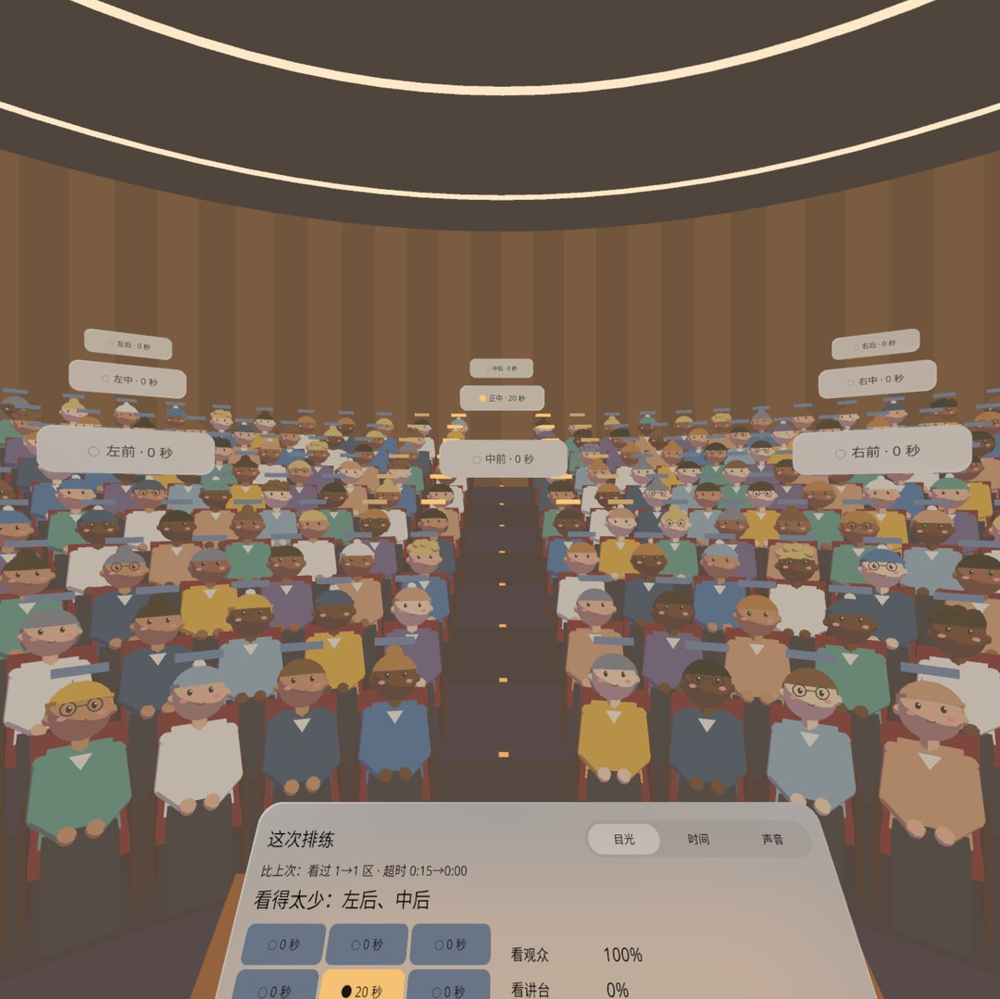
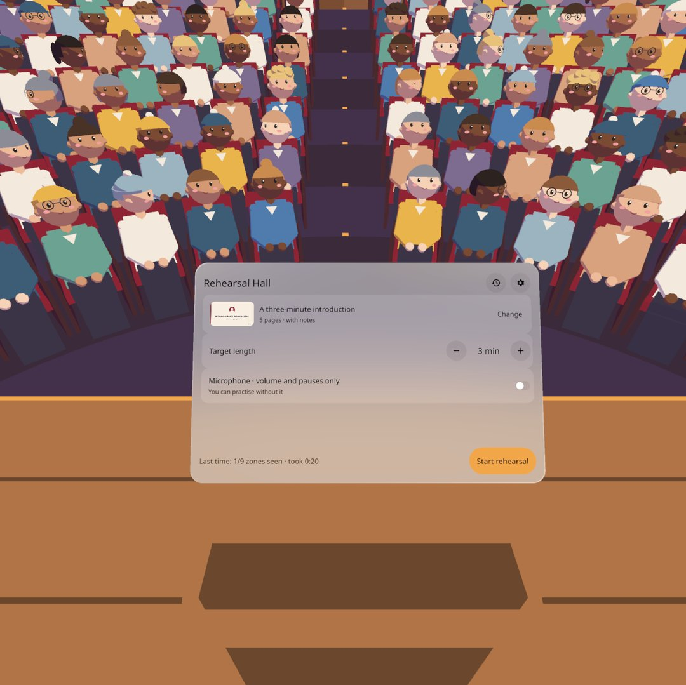
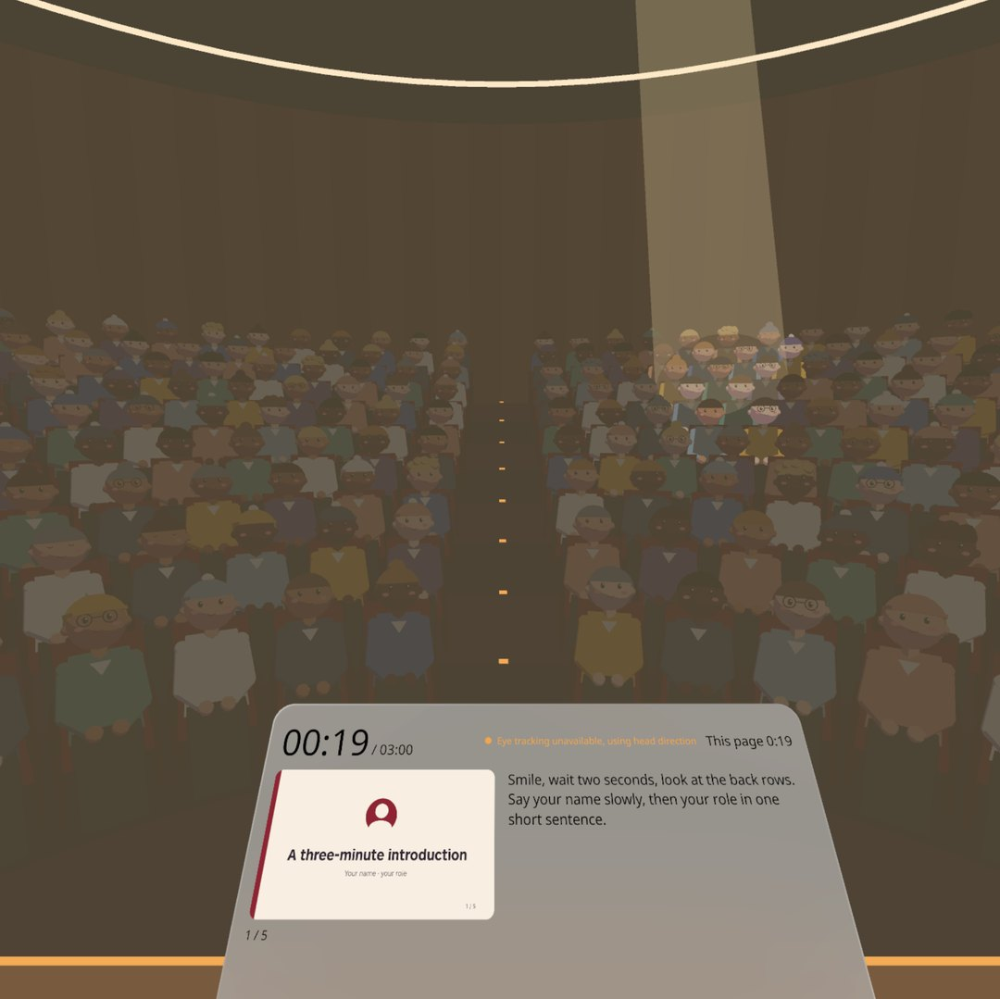
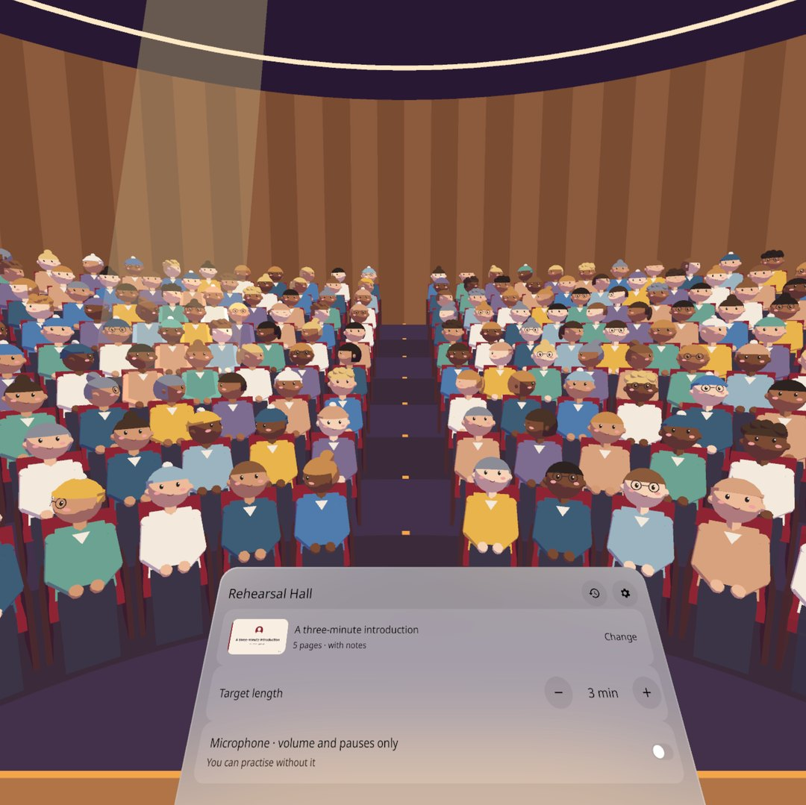

# 演讲排练厅 · Rehearsal Hall

<p align="center"></p>

**中文** · [English](#english)

站上坐满观众的礼堂，把稿子讲一遍；讲完灯一亮，座位被你的目光染色——哪片观众你一眼都没看，一眼就知道。PICO OS 6 空间应用（Stage · Full 全沉浸）。



## 能做什么

- **站在台上讲**：阶梯礼堂 9 排 168 座，后排离你 12 米、比你眼睛高 1.5 米；投影幕显示当前幻灯片，讲台上一块面板做提词器（备注、总计时 / 目标、本页计时、上一页 / 下一页）。
- **卡通观众**：168 个程序生成的圆头卡通人（6 种发型、5 种肤色、8 种衣服颜色、两成戴眼镜），会转头看你、眨眼；你看向哪一片超过 1.5 秒，那里有人点头微笑；某一列一直被冷落，那一列的中后排就低头看手机，你看回去就抬头；讲完全场鼓掌。
- **看哪里，用眼动追踪**：第一次进来会申请眼动权限（`com.picovr.permission.EYE_TRACKING`），注视射线来自 SDK 的 `EyeTrackingProvider`；没有权限或设备不支持时自动改用头部朝向，讲台面板上写「眼动不可用，改用头部朝向」，设置里可以重新允许。每一帧分成「看观众 / 看讲台 / 背对观众 / 其他」，看观众时记到 9 个分区（左中右 × 前中后）。
- **目光看得见**：讲的时候，舞台上方的追光会柔和地打到你正在看的那片座位上，地面上一圈暖光，光里的 3–5 位观众微微亮起；讲完的座位热力图照旧保留。
- **报告**：灯亮，每个座位上方一块色块，9 块分区牌「左后 · 0 秒」浮在礼堂里；讲台面板分「目光 | 时间 | 声音」三栏——一句结论（如「看得太少：左后、中后」）、3×3 方格、每页时长条、比上次。
- **回看**：4 倍速，一束光按你当时的朝向扫过座位，投影幕跟着换页。
- **稿子**：内置「三分钟自我介绍」示例稿（中英各一份），或导入 PDF / 图片（最多 60 页），备注可另导入一个 TXT（`---` 分页）；也可以「不用幻灯片，直接讲」。
- **麦克风可选**：只在头显里算开口占比、最长停顿、音量是否偏小，不录音；不开麦克风其他功能完全不受影响。
- **全离线**：没有网络权限；可选权限只有眼动和麦克风。中英双语，设置里随时切换。

| | |
|---|---|
|  讲中：场灯降下，追光落在你看的前排；面板显示计时、缩略图与备注 |  左列被冷落太久，中后排低头看手机（发光的小方块） |
|  报告：座位色块 + 9 块分区牌 + 3×3 方格 |  回看：光束按记录的朝向扫过座位 |
|  中文界面：「看得太少：左后、中后」 |  v0.1.1：讲台面板整块浮在讲台之上 |
|  v0.1.2：追光跟着目光落在右后区 |  准备时场灯全亮，追光仍看得出落点 |

> 截图全部来自 PICO 模拟器，由调试命令驱动（设头朝向、切状态），**不是真实手势录像**。

## 安装

```bash
adb install -r RehearsalHall-v0.1.2.apk
pico-cli app launch io.embodit.rehearsalhall
```

APK 在 [Releases](../../releases) 里（debug 签名）。需要 PICO OS 6.1 头显（Swan）或 PICO 模拟器。

## 已知问题（v0.1.2）

- 眼动追踪只能在头显上用：模拟器没有眼动（一直走头部朝向回退）；眼动射线的精度、权限弹窗在全沉浸里是否出现，都待真机确认。
- 观众「亮起」是换成更亮的材质：场灯全亮（准备页）时提亮不明显，主要靠追光看出落点。

- 讲中 / 暂停时场灯降到 15%，整场蒙一层橄榄褐色，更像雾而不像暗场（设计是深紫黑）。
- 模拟器上冷启动约 15–21 秒（建 220 个网格，每个约一帧）；头显上应快得多，未实测。
- 默认平视时讲台面板只露上沿，要低头才看全——这是真实讲台的位置，但第一次进来可能找不到按钮。
- 回看时「光锥扫到的座位短暂亮起」没做；礼堂只有中央过道，两侧台阶过道没做。
- 首次提示（M5）、上次中断提示（M8）、从历史打开的只读报告（M6）在 QA 截图里没单独拍到（M8 研发时验证过）。
- 本版没有演示视频。

## 需要真机验证

眼动追踪（权限弹窗、注视精度、追光是否落在你看的地方）；扳机翻页（右扳机下一页、左扳机上一页）；麦克风授权弹窗在全沉浸里是否出现、收音阈值；系统文件选择器在全沉浸里能否打开；真实头动下的分区判定；168 人 + 走神时的帧率；头显上场景建造时长；暗场下面板对比度；站在台上的尺度感。

## 开发

Kotlin + PICO Spatial SDK 6.1.9；所有 2D 界面用 SpatialUI + PicoTheme（不用 Material）。结构、调试广播、截图清单见 [AGENTS.md](AGENTS.md)。设计包在 `docs/context/`。

---

<a id="english"></a>

# Rehearsal Hall

Give your talk on the stage of a full auditorium. When the lights come up, every seat is tinted by how long you looked at it, so the part of the room you ignored is obvious at a glance. A PICO OS 6 spatial app (immersive Stage · Full).

## What it does

- **Talk from the stage**: a raked hall with 9 rows and 168 seats; the back row is 12 m away and 1.5 m above your eyes. The screen shows the current slide; a panel on the lectern is your prompter (notes, total time vs target, time on this page, previous / next).
- **A cartoon audience**: 168 procedurally built round-headed listeners (6 hair styles, 5 skin tones, 8 clothing colours, a fifth wear glasses). They turn to you and blink; look at a part of the room for 1.5 s and a few people there nod and smile; ignore a column for long enough and its middle and back rows look down at their phones until you look back; they clap at the end.
- **Where you look = eye tracking**: on first entry the app asks for the eye-tracking permission (`com.picovr.permission.EYE_TRACKING`) and takes the gaze ray from the SDK's `EyeTrackingProvider`; without the permission or on a device without eye tracking it falls back to the head direction and the lectern panel says "Eye tracking unavailable, using head direction" (Settings can ask again). Every frame counts as audience / lectern / back turned / other; audience time goes to one of 9 zones (left · centre · right × front · middle · back).
- **You can see your gaze**: while you talk, a soft follow-spot from above the stage lands on the seats you are looking at, with a warm pool on the floor and the 3–5 listeners in it lit a little; the seat heat map after the talk stays as before.
- **Report**: the lights come up, a colour tag above every seat, nine zone signs ("Back left · 0 s") in the hall; on the lectern: Eyes | Time | Voice — a one-line verdict ("Missed: Back left, Back center"), a 3×3 grid, time per slide, and a comparison with last time.
- **Replay**: 4× speed; a light beam sweeps the seats along your recorded head direction while the screen changes slides.
- **Talks**: a built-in "three-minute introduction" (Chinese and English), or import a PDF / images (up to 60 pages) plus notes as a TXT (`---` between pages); or talk without slides.
- **Optional microphone**: speaking ratio, longest pause and whether you were quiet, worked out in the headset; nothing is recorded, and everything else works without it.
- **Fully offline**: no network permission; the only optional permissions are eye tracking and the microphone. Chinese / English, switchable in Settings.

> All screenshots are from the PICO emulator, driven by debug commands (head direction, state jumps). **They are not recordings of real gestures.**

## Install

```bash
adb install -r RehearsalHall-v0.1.2.apk
pico-cli app launch io.embodit.rehearsalhall
```

The APK is under [Releases](../../releases) (debug-signed). Needs a PICO OS 6.1 headset (Swan) or the PICO emulator.

## Known issues (v0.1.2)

- Eye tracking works on the headset only: the emulator has none (it always uses the head-direction fallback); gaze accuracy and whether the permission dialog shows over a Full Stage still need a headset check.
- "Lit" listeners switch to a brighter material: with the house lights fully up (setup page) the change is subtle; the follow-spot shows where you look.

- With the house lights at 15 % (talking / paused) the hall gets an olive-brown haze rather than a dark plum house.
- Cold start on the emulator takes about 15–21 s (220 meshes, about one frame each); the headset should be much faster, not measured yet.
- Looking straight ahead you only see the top edge of the lectern panel; you look down to use it, like a real lectern, but first-time users may not find the buttons.
- Replay does not light up the seats the beam passes; the hall has only a centre aisle, no side aisles.
- The first-run tip (M5), the "last rehearsal was interrupted" tip (M8) and the read-only report from history (M6) were not captured separately in QA (M8 was checked during development).
- No demo video in this release.

## Needs a headset to verify

Eye tracking (permission dialog, gaze accuracy, the follow-spot landing where you look); trigger page turns (right = next, left = previous); whether the microphone permission dialog and the system file picker open over a Full Stage, and the voice thresholds; zone accuracy with real head movement; frame rate with 168 listeners drifting; scene build time; panel contrast in the dark; the sense of scale on stage.

## Development

Kotlin + PICO Spatial SDK 6.1.9; all 2D UI is SpatialUI inside PicoTheme (no Material). Structure, debug broadcast and the screenshot list: [AGENTS.md](AGENTS.md). Design package: `docs/context/`.

## Third-party

- Noto Sans and Noto Sans SC (SIL Open Font License 1.1): `third_party/noto-sans`, `third_party/noto-sans-sc`.
- All 3D content and the sample slides are generated in code; no external models or images.
